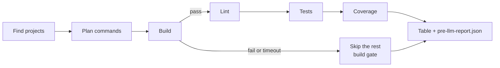

# Pre-LLM Checks

## What it is

Pre-LLM Checks runs a repo's own build, lint, tests and coverage before an AI reviews the code.
It prints a table for people and writes `pre-llm-report.json` for the AI.
It uses no AI itself. It only gathers evidence.
It needs Python 3.11 or newer and no third-party packages.

## Trust warning

The tool is read-only, but the scripts it runs are not. It runs the scripts and tools the repo itself defines, and those can do anything.
Only run it on code you trust. Use `--dry-run` first to see every command it would run. There is no sandbox in v1.
Every run prints a one-line notice naming the folder before anything runs.

## Golden rules

- Read-only: it never changes your code, never installs anything, never runs fixers or formatters.
- It only runs project-defined tools. A package listed in devDependencies, with no script and no config, is not enough.
- Commands run as argument lists (`shell=False`), from the project's own folder.
- The only file it may ever change is `.gitignore`, and only with `--add-gitignore`.
- Secrets are masked in the table, the report and the logs.
- Paths in the report are relative to the repo root and use forward slashes.
- A report is always written, even after an error or Ctrl+C.

## Quick start

Windows (PowerShell):

```powershell
py -3 path\to\pre_llm_checks.py --path C:\code\my-repo --dry-run
py -3 path\to\pre_llm_checks.py --path C:\code\my-repo
```

macOS / Linux:

```bash
python3 path/to/pre_llm_checks.py --path ~/code/my-repo --dry-run
python3 path/to/pre_llm_checks.py --path ~/code/my-repo
```

Without `--path` it checks the current folder.
The report goes to `pre-llm-report.json` in the current folder (change it with `--output`).
Full command logs go to `.pre-llm/logs/` inside the checked repo. `--add-gitignore` adds `.pre-llm/` to the repo's `.gitignore`; without it you get a `gitignore_missing` warning if logs are not ignored.

Other flags: `--steps build,lint,tests,coverage`, `--lint-anyway`, `--verbose`, `--timeout-build` / `--timeout-lint` / `--timeout-tests` / `--timeout-coverage`, `--tail-lines`, `--config`, `--version`.

## How a run works



- **Find projects**: a project is a folder with a build file (`package.json`, `pom.xml`, `pyproject.toml`, ...). Folders like `node_modules`, `.git`, `build`, `dist`, `target`, `vendor` and `.venv` are skipped.
- **Plan commands**: for each stage it picks the commands the project defines (see below).
- **Build gate**: if Build fails or times out, the other stages of that project are skipped. `--lint-anyway` still runs Lint. Leaving `build` out of `--steps` turns the gate off. Each project is independent.
- **Tests gate**: if Tests fail or time out, Coverage is skipped and not run. If Tests ran but found no tests, Tests is `SKIP` and Coverage is `FAIL` ("no tests found"), so the exit code is 1. A project with no tests command at all, or a run whose `--steps` leaves out `tests`, is not affected.
- **Timeouts**: Build 10m, Lint 5m, Tests 15m, Coverage 15m. Change them with `--timeout-build 90s`, `--timeout-tests 1h30m`, and so on. On a timeout the whole process tree is killed.
- **Ctrl+C**: the running command's process tree is killed, it is marked `interrupted`, the report is still written, and the exit code is 130.
- **Coverage**: it reads JaCoCo XML, Cobertura XML, Istanbul json-summary, lcov and a few more, but only files written during this run. If there is none, it tries to read a percentage from the output. The table shows the lowest line percentage. There is no threshold.

## How it decides what to run

A command only counts if the project itself defines it. There are four sources, plus your overrides:

1. **Scripts in the build file**: for example `"lint"` or `"test"` in `package.json`. Names match by exact name or prefix (`lint` and `lint:types` both count as Lint).
2. **Config files**: a linter config next to the build file, such as `.golangci.yml`, `.rubocop.yml` or `tsconfig.json`.
3. **Plugins in the build file**: for example `maven-checkstyle-plugin` or `jacoco` in `pom.xml` / `build.gradle`.
4. **Tools built into the language**: such as `mvn test`, `go test ./...`, `cargo build` or `dotnet build`.
5. **`pre-llm.toml` overrides**: a command you write there replaces what would have been found for that stage.

Never run: scripts whose names end in `:fix`, `:watch`, `:dev`, `:serve`, `:e2e`, `:docker` or `:deploy`; scripts named `dev`, `serve`, `deploy` or `docker`; and any command using `--fix` or `--write`. They are listed in the report under `skipped_scripts` with the reason. Identical commands run once.

Wrappers win: if a project has `mvnw` or `gradlew` (`.cmd` / `.bat` on Windows), that runs instead of `mvn` or `gradle`.

## Statuses and exit codes

Each table cell shows the worst result of that stage.

| Cell | Meaning |
|---|---|
| `PASS` | Every command passed. For Coverage, the lowest line percentage is shown instead (e.g. `72.0%`). |
| `FAIL` | A command failed, or Coverage when no tests were found. |
| `TIMEOUT` | A command ran out of time. Counts as a failure. |
| `WARN` | Not a code failure: no linter configured, tool not installed, dependencies missing, or no coverage data. |
| `SKIP` | Did not run: build gate, tests failed (Coverage), nothing to run, no tests found (Tests), or the stage was not asked for. |
| `INTR` | Interrupted by Ctrl+C. |

| Exit code | Meaning |
|---|---|
| 0 | Everything passed, or only warnings. |
| 1 | Something failed or timed out. |
| 2 | Script error: bad flag, bad path, bad `languages.toml` or `pre-llm.toml`, or an internal error. |
| 3 | No supported project found. |
| 130 | Interrupted (Ctrl+C). |

## The report

`pre-llm-report.json` is written on every run except `--dry-run` (early errors still write one, with `summary.status` set to `error` or `no_project`). A shortened example:

```json
{
  "schema_version": "1.0",
  "summary": {
    "status": "fail",
    "project_count": 1,
    "counts": {"pass": 2, "fail": 1, "timeout": 0, "warning": 1, "skipped": 0, "interrupted": 0},
    "generated_at": "2026-10-13T13:10:14+00:00"
  },
  "warnings": ["gitignore_missing"],
  "projects": [
    {
      "path": ".",
      "language": "python",
      "build_files": ["pyproject.toml"],
      "skipped_scripts": [],
      "commands": [
        {
          "command": ["pytest"],
          "scripts": null,
          "source": "config",
          "status": "fail",
          "duration_s": 1.4,
          "output_tail": ["FAILED test_calc.py::test_add - assert 3 == 4", "1 failed, 2 passed"],
          "log_path": ".pre-llm/logs/_root_/tests-0.log",
          "findings": null,
          "stage": "tests",
          "reason": null
        }
      ],
      "warnings": ["coverage_missing"]
    }
  ],
  "environment": {
    "os": "Windows 11",
    "runners": {"pytest": "pytest 8.3.4"}
  }
}
```

| Field | What it holds |
|---|---|
| `schema_version` | Version of the report's shape. |
| `summary.status` | `pass`, `fail`, `interrupted`, `error` or `no_project`. |
| `summary.project_count` | Number of projects found. |
| `summary.counts` | Table cells by status, one per project per stage: `pass` (a coverage percentage counts as pass), `fail`, `timeout`, `warning`, `skipped`, `interrupted`. Same words as the table. |
| `summary.generated_at` | When the report was made, UTC, ISO 8601. |
| `warnings` | Repo-level warnings, such as `gitignore_missing` or `no_project: <folder>`. |
| `projects[]` | One entry per project: `path`, `language`, `build_files`, `skipped_scripts`, `commands`, and `warnings` / `coverage` when there are any. |
| `projects[].commands[]` | One entry per command: `command` (secrets masked), `source`, `status`, `duration_s`, `output_tail` (last 50 lines by default, each cut at 500 characters), `log_path`, `findings` (always `null` in v1), `stage`, `reason`. |
| `environment` | The OS and the version of each runner that actually ran (`unknown` if it could not be read). |
| `truncated` | Present and `true` only if the report went over about 200 KB and output tails were trimmed. |

**Rule:** any change to the report's shape bumps `schema_version`. `tests/test_report_schema.py` enforces this: it fails when the shape changes until `_REPORT_SCHEMA_VERSION` in `pre_llm_checks.py` is bumped and the golden file is regenerated.

## Languages

All rules live in `languages.toml`. "Tested" means every applicable fixture matched `tests/fixtures/EXPECTED.md`; untested languages are labelled `[untested]` in the table.

| Language | Build files | Tested |
|---|---|---|
| Python | `pyproject.toml`, `requirements.txt` | yes |
| JavaScript / TypeScript | `package.json` | yes |
| Java (Maven, Gradle) | `pom.xml`, `build.gradle`, `build.gradle.kts` | yes |
| Kotlin (Gradle) | `build.gradle`, `build.gradle.kts` | yes |
| Go | `go.mod` | yes |
| C# / .NET | `*.sln`, `*.slnx`, `*.csproj` | yes |
| Rust | `Cargo.toml` | no |
| PHP | `composer.json` | no |
| Ruby | `Gemfile` | yes |
| Swift (SwiftPM) | `Package.swift` | no |
| C / C++ | `CMakeLists.txt`, `Makefile`, `meson.build` | no |

## pre-llm.toml

Optional, at the repo root, written by the repo owner. It supports only `ignore` and per-project stage overrides (`build`, `lint`, `tests`, `coverage`).

```toml
ignore = ["legacy", "generated"]

[[project]]
path = "backend"
lint = "npm run check-style"
tests = "pytest -q"
```

`path` is relative to the repo root. An override counts as project-defined.

## Adding a language

1. Add a `[language.<name>]` entry to `languages.toml` (extensions, build files, stage names, config files, built-in commands, coverage files). No code change should be needed.
2. Add fixtures in `tests/fixtures/` (`<name>-ok`, `-build-fail`, `-test-fail`, `-lint-fail`, `-no-tests`, `-no-linter` where they apply).
3. Add the expected results to `tests/fixtures/EXPECTED.md`.
4. Add the `-ok` fixture to `tests/test_fake_runs.py`, generate its golden file with `UPDATE_GOLDEN=1`, review it, and commit it.
5. Set `tested = true` only when every applicable fixture matches.

## Testing

```powershell
py -3 -m pytest -q
```

On macOS / Linux use `python3 -m pytest -q`. `pytest` is the only thing you need for the tests; the tool itself needs nothing.

- `tests/test_fake_runs.py` replaces the real command runner with a fake, so every language's planning and status logic is checked on any machine, even without Rust, PHP, Swift or a C++ compiler installed.
- `tests/test_report_schema.py` guards the report's shape.
- `tests/manual_*_check.py` are scripts you run by hand against the fixtures with the real tools, e.g. `py -3 tests/manual_cli_check.py`.

Refresh golden files after an intended change (PowerShell):

```powershell
$env:UPDATE_GOLDEN=1; py -3 -m pytest tests/test_fake_runs.py tests/test_report_schema.py; Remove-Item Env:UPDATE_GOLDEN
```

macOS / Linux: `UPDATE_GOLDEN=1 python3 -m pytest tests/test_fake_runs.py tests/test_report_schema.py`.
Review the diff in `tests/golden/` before you commit. Without `UPDATE_GOLDEN`, a missing golden file fails the test; it is never created silently.

## Not in v1

- Running projects in parallel
- Filtering by language
- Checking changed files only
- Coverage thresholds
- Installing dependencies
- CI or remote integration
- A sandbox
- Zip, git URL or single-file input
- Tool-specific finding parsers (JUnit XML, then SARIF readers, come first later)
